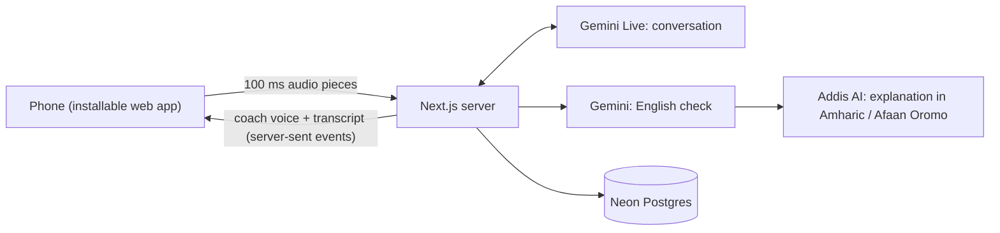

# Lisane AI (ልሳኔ AI)

> English should never be the reason talented Ethiopians miss opportunities.

Lisane AI is a voice-first app that helps Ethiopians who understand English become confident English speakers. You practise real conversations, like a job interview, with an AI coach that speaks with you. You get one kind correction per turn, explained in Amharic or Afaan Oromo by [Addis AI](https://addisassistant.com), and the conversation is built to keep going on weak mobile networks.

**Try it:** https://lisane-ai.onrender.com (backup: https://lisane-seven.vercel.app). Create an account with any email and password, choose your support language, then open **Speak**.

## The problem

Many Ethiopians read and understand English well but freeze when they have to speak it: in a job interview, at work, or at university, where English is often required. Most AI tutors are typed chats. They explain mistakes in English or in stiff machine translation, and they break on weak mobile connections.

## What Lisane does

- **Speak anytime.** Have a live voice conversation with a kind AI coach. Talk freely, pick a real situation (introducing yourself, a job interview, at work, at university), or type any situation you want to practise. Choose auto listening, or long answer mode where you tap "I'm done speaking".
- **One gentle correction per turn.** The coach says the better sentence out loud. A note under your line explains the fix in your support language, written by Addis AI, a model built for Ethiopian languages.
- **Built for weak networks.** Your voice is sent in small pieces that are retried if they fail. The coach's stream reconnects instead of ending the talk, and your conversation is saved on the phone.
- **Review.** After a conversation, read back what you and the coach said, with every correction.
- **Your language everywhere.** It's an installable web app with the whole interface in English, Amharic and Afaan Oromo.

## How it works



1. The phone records the microphone in an audio worklet, converts it to 16 kHz audio, and sends it to the server in pieces of about 100 ms, one request at a time. Silence is not sent; when the learner pauses, the phone tells the server the turn is over. While the coach speaks, the microphone is held back, so the coach never hears itself.
2. The server relays the audio to a Gemini Live session, one per conversation, so API keys never reach the phone. The coach's voice and transcript stream back over server-sent events with a keep-alive ping.
3. When a learner turn ends, Gemini checks the English and returns at most one correction. Addis AI writes the explanation in the learner's support language, falling back to Addis translation and then Gemini if needed. The note appears under that turn.
4. On a weak connection, a failed audio piece goes back to the front of the queue and is retried up to three times with growing waits. If the event stream drops, the app shows that it is reconnecting and keeps trying for 45 seconds. If it cannot recover, the conversation is saved on the phone and comes back when you start again.

Languages come from one registry, [`lisane/src/config/languages.ts`](lisane/src/config/languages.ts). Adding another Ethiopian language, such as Tigrinya, comes down to the registry, the interface strings and a review pass. Amharic and Afaan Oromo strings are drafted with Addis AI and listed in [`lisane/messages/REVIEW.md`](lisane/messages/REVIEW.md) for native-speaker review.

## Tech stack

- Next.js 16 (App Router), React 19, Tailwind CSS 4, next-intl
- Gemini Live (`gemini-3.1-flash-live-preview`) for the voice conversation, and Gemini Flash-Lite for the English check
- Addis AI (`addisai` SDK) for Amharic and Afaan Oromo explanations and translation
- Better Auth, Prisma 7 and Neon Postgres
- Serwist for the installable app

## Run it locally

You need Node 24, pnpm 12, a Postgres database (for example Neon), a Gemini API key and an Addis AI API key.

```bash
cd lisane
pnpm install
cp .env.example .env.local   # fill in DATABASE_URL, BETTER_AUTH_SECRET, GEMINI_API_KEY, ADDIS_API_KEY
pnpm exec prisma migrate deploy
pnpm db:generate
pnpm curriculum:sync
pnpm dev
```

English lesson audio is shipped as short MP3 files. When authoring new listening or dictation prompts, run `pnpm curriculum:audio` with the local Gemini key, then `pnpm curriculum:audio:check`. Keep the generated clips with the curriculum changes. Builds serve the clips directly.

Open http://localhost:3000. Checks: `pnpm typecheck`, `pnpm lint`, and `node --test "src/**/*.test.ts"` for the unit tests.

## Deploy

Live conversations are held in the server's memory, so run one long-lived server instance. On Render, create a web service with root directory `lisane`, build command `npm install -g pnpm@12.21.0 && pnpm install --frozen-lockfile && pnpm exec prisma migrate deploy && pnpm build && pnpm curriculum:sync`, start command `pnpm start`, and the environment variables from [`lisane/.env.example`](lisane/.env.example), with `BETTER_AUTH_URL` and `NEXT_PUBLIC_APP_URL` set to the service address.

## Roadmap

Done: accounts and onboarding (goal, English level, support language, daily goal), the localized interface, the installable app, the live voice coach, weak-connection handling, corrections in the support language, situations and your own idea, and the session review.

Next: Addis AI speech so you can speak and hear Amharic and Afaan Oromo inside the conversation, memory of your recent topics and weak points, a Duolingo-style learning path, spaced-repetition practice built from your own mistakes, progress and streaks, offline lessons, and payments through Chapa.
